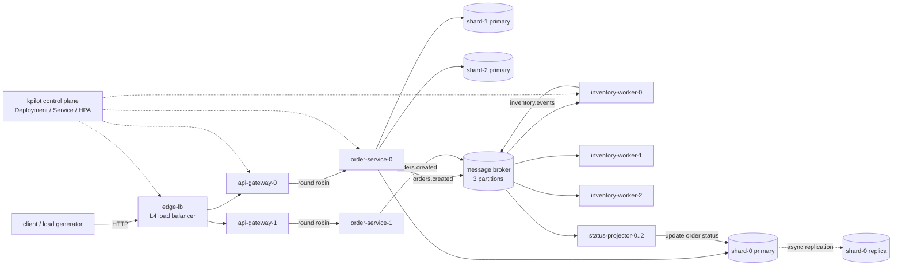

# shop-mesh

**A runnable demonstration of large-system engineering:** microservices with an
API gateway, a partitioned message broker, replicated stateless services,
sharded databases with read replicas, L4/L7 load balancing, and
Kubernetes-style horizontal autoscaling - with system and reliability tests that
prove the behaviour instead of describing it.

No Docker, Kubernetes, PyPI or external services are required to run or test it:
every service is a real OS process, the control plane (`kpilot`) implements the
Kubernetes primitives this system uses, and the whole stack is pure Python 3.11
standard library. Production manifests (Docker, Compose, Kubernetes, HPA, PDB,
Ingress, Prometheus/Grafana) live in `deploy/`.

---

## What is demonstrated

| Concern | Implementation | Proof |
|---|---|---|
| Microservices, independent deployment | 6 service types, 18 processes in the demo topology | `tests/system` |
| Message broker, consumer groups, DLQ | `services/message_broker` (partitions, offsets, retries) | `tests/integration/test_broker_semantics.py` |
| API gateway | auth, per-key token bucket, routing, retries, circuit breaker | `tests/integration/test_gateway_policies.py` |
| Replicated services + load balancer | round-robin `EndpointPool`, passive ejection, `edge-lb` L4 proxy | `tests/system/test_gateway_contract.py`, `tests/reliability/test_pod_failure.py` |
| Sharded databases | consistent-hash placement over 3 SQLite shards | `tests/unit/test_hashing.py`, `tests/system/test_sharding.py` |
| Database replicas and failover | async replication + replica promotion | `tests/unit/test_storage_client.py`, `tests/reliability/test_database_failover.py` |
| Autoscaling on overload | kpilot HPA on inflight (Little's law) + real HPA v2 manifests | `tests/reliability/test_autoscaling.py` |
| Backpressure end-to-end | bounded concurrency, broker backlog limit, `Retry-After` | `tests/reliability/test_backpressure.py` |
| Exactly-once stock decrement | transactional idempotency key in the storage node | `tests/integration/test_consumer_worker.py` |

---

## Architecture



### Synchronous path (order intake)

```
POST /api/v1/orders
  -> edge-lb            round robin across gateway replicas (L4)
  -> api-gateway        X-API-Key auth, 400 rps/key quota, retries, breaker
  -> order-service      validate, idempotent write to the customer's shard
  -> storage-node       SQLite primary; replicated to the shard's read replica
  -> broker             publish orders.created (key = customer_id)
  <- 202 Accepted       Location + X-Order-Status: PENDING
```

### Asynchronous path (fulfilment)

```
inventory-worker (group=inventory, one pod per partition)
  -> decrement stock with idempotency key order:<order_id> (exactly once)
  -> publish inventory.events (CONFIRMED / REJECTED + reason)
status-projector (group=order-status, one pod per partition)
  -> project the outcome onto the order aggregate
GET /api/v1/orders/{id}  -> CONFIRMED | REJECTED | PENDING
```

---

## Service catalog

| Service | Replicas (demo) | Scale policy | Responsibility |
|---|---|---|---|
| `edge-lb` | 1 | fixed (Ingress in K8s) | L4 proxy, connection cap, 503 load shedding |
| `api-gateway` | 2 | HPA, inflight target 20, max 4 | auth, quota, routing, retries, breakers |
| `order-service` | 2 | HPA, inflight target 2.8/pod, max 6 | order intake, sharded persistence, publish |
| `inventory-worker` | 3 | fixed = partitions | stock reservation, exactly-once decrement |
| `status-projector` | 3 | fixed = partitions | CQRS read-model projection |
| `message-broker` | 1 | fixed (StatefulSet) | partitions, consumer groups, retries, DLQ |
| `storage-<shard>-primary` | 3 | fixed (StatefulSet) | SQLite shard primary (writes) |
| `storage-<shard>-replica` | 3 | fixed | read replica (async replication) |
| `kpilot` | 1 | local only | Deployments, Service registry, HPA, chaos |

Worker tiers are intentionally **not** autoscaled beyond their partition count:
that is a correctness constraint of consumer groups, not an omission (see
`docs/adr/0005-partition-bound-workers.md`).

---

## Quickstart (no dependencies)

```bash
# 1. start the whole topology: 12 deployments, 18 pods, one control plane
python3 -m services.kpilot --base-port 21000 --runtime-dir runtime/demo --profile demo

# 2. (new terminal) seed stock into the correct shards
python3 -m scripts.seed_inventory --base-port 21000 --skus 5 --stock 500

# 3. place an order through the edge load balancer
curl -s -X POST http://127.0.0.1:21060/api/v1/orders \
  -H 'Content-Type: application/json' \
  -H 'X-API-Key: demo-key' \
  -H 'Idempotency-Key: demo-1' \
  -d '{"customer_id":"cust-42","sku":"sku-1","quantity":2}'

# 4. read it back (PENDING -> CONFIRMED is asynchronous)
curl -s http://127.0.0.1:21060/api/v1/orders/<order_id> -H 'X-API-Key: demo-key'

# 5. inspect the control plane and the autoscaler decisions
curl -s http://127.0.0.1:21090/status | python3 -m json.tool
curl -s http://127.0.0.1:21090/events | python3 -m json.tool

# 6. generate load and watch order-service scale out
python3 -m services.load_generator --port 21060 --rate 100 --duration 20 --workers 20
watch -n1 'curl -s http://127.0.0.1:21090/deployments/order-service | python3 -c "import json,sys; d=json.load(sys.stdin); print(d[\"desired_replicas\"], [(p[\"pod\"], p[\"ready\"]) for p in d[\"pods\"]])"'
```

Or run the scripted end-to-end demo (starts, seeds, loads, prints a report, stops):

```bash
make demo
```

### Port map (base port + offset)

| Offset | Listener |
|---|---|
| +0 .. +5 | storage shards: 0-primary, 0-replica, 1-primary, 1-replica, 2-primary, 2-replica |
| +10 | message broker |
| +20 .. +29 | order-service replicas |
| +40 .. +49 | api-gateway replicas |
| +60 / +61 | edge-lb proxy / admin (health, metrics) |
| +70 .. +72 | inventory-worker replicas |
| +80 .. +82 | status-projector replicas |
| +90 | kpilot control plane (status, events, scale, kill) |

---

## Public API

All requests go through the edge LB -> gateway and require `X-API-Key`
(`demo-key` / `load-test-key` in the local profile).

| Method | Path | Notes |
|---|---|---|
| `POST` | `/api/v1/orders` | `customer_id`, `sku`, `quantity` 1-100. Send `Idempotency-Key` for safe retries. `202` + `Location` |
| `GET` | `/api/v1/orders/{id}` | `?consistent=true` reads the shard primary instead of a replica |
| `GET` | `/api/v1/system/status` | gateway config, upstream replicas, breaker states |

Error contract:

```json
{"error": {"code": "rate_limited", "message": "rate limit exceeded", "request_id": "..."}}
```

| Status | When | Header |
|---|---|---|
| 400 | validation failure | - |
| 401 | missing/invalid API key | - |
| 404 | unknown order / route | - |
| 429 | API key quota exhausted | `Retry-After` |
| 503 | upstream unreachable, circuit open, admission control, broker backpressure | `Retry-After` |
| 202 | accepted, processing continues asynchronously | `Location`, `X-Order-Status` |

---

## Delivery and failure semantics

| Situation | Behaviour |
|---|---|
| Duplicate `POST` with same `Idempotency-Key` | same order returned, no second event |
| Duplicate `orders.created` delivery | stock decremented once (storage-node idempotency key) |
| Worker crashes before ack | broker redelivers after backoff (at-least-once) |
| Message fails `MAX_ATTEMPTS` | moved to `<topic>.dlq` with error + original payload |
| Consumer group lag > `MAX_BACKLOG` | publish rejected `503` + `Retry-After` (backpressure) |
| Gateway upstream 5xx/timeout | retried on another replica (idempotent requests only), breaker counts failures |
| Whole order-service replica dies | removed from Service endpoints by readiness probe, replaced by kpilot/Kubernetes |
| Storage primary dies | reads continue from replica; client promotes replica after N failures |
| Read replica down | reads fall through to primary, replication retries in the background |
| Overload at a process | fast `503` with `Retry-After` instead of queueing without bound |

---

## Testing

Strategy: [`docs/testing.md`](docs/testing.md). Stress plan: [`docs/stress-testing.md`](docs/stress-testing.md).
Plan/iterations: [`docs/plan.md`](docs/plan.md).

```bash
make lint              # compileall + import check + manifest invariants
make test              # unit + integration (seconds, no cluster)
make system-test       # full cluster end-to-end
make reliability       # autoscaling, pod kill, consumer crash, DB failover, backpressure
make test-all          # everything, JUnit XML in runtime/test-reports/, evidence in docs/results/
```

Tests use the standard `unittest` runner; `scripts/run_tests.py` adds JUnit XML
(CI-consumable) and a markdown summary. Reliability tests record the control
plane's actual scaling events, so the claim "it scales out under load" is backed
by data in `docs/results/`.

---

## Kubernetes and containers

`deploy/` contains the production expression of the same topology:

* `deploy/docker/*` - one slim, non-root image per service with a `/readyz` healthcheck
* `deploy/compose/docker-compose.yml` - single-command local stack
* `deploy/k8s/*` - Namespace, ConfigMap, Secret, Deployments (probes, resources),
  Services, Ingress, HPA v2 (CPU + inflight), PodDisruptionBudgets, NetworkPolicy,
  storage StatefulSets with PVCs, broker StatefulSet
* `deploy/load/k6.js` - standard-tool stress test (the built-in generator is the
  dependency-free fallback)
* `deploy/observability/` - Prometheus scrape config and Grafana dashboard

```bash
python -m scripts.validate_manifests   # structural + invariant checks, no cluster
kubectl apply -k deploy/k8s            # requires a cluster + ingress controller
```

The local control plane (`kpilot`) implements the subset of Kubernetes this
demo relies on: Deployments with readiness probes, Service endpoints, HPA,
CrashLoopBackOff-ish restarts and chaos kills. Ports, env names and scaling
policies are kept in sync between `services/kpilot/spec.py` and `deploy/k8s`.

---

## Repository layout

```
libs/mesh/              shared platform library (no business logic)
  httpkit.py            HTTP server/client, admission control, probes, metrics endpoints
  metrics.py            Prometheus + JSON metrics
  logging.py            JSON logs with request/trace ids
  discovery.py          file-based Service registry, round-robin pool, ejection
  resilience.py         token bucket, circuit breaker, retry helper
  hashing.py            consistent hash ring (shard placement)
  storage.py            sharded + replicated store client, primary failover
  broker.py             broker client, producer, partition consumer
services/
  edge_lb/              L4 load balancer (Ingress equivalent locally)
  api_gateway/          auth, quota, routing, retries, circuit breaker
  order_service/        stateless order API + repository (idempotent writes)
  inventory_worker/     consumer-group worker + pure handler
  status_projector/     CQRS projection worker
  message_broker/       partitioned log, consumer groups, retries, DLQ
  storage_node/         SQLite shard with optimistic concurrency + idempotent mutate
  kpilot/               local control plane: Deployments, Services, HPA, chaos
  load_generator/       dependency-free open-loop load generator
tests/                  unit / integration / system / reliability + harness
scripts/                seed data, test runner, demo, stress, manifest validation
deploy/                 docker, compose, kubernetes, observability, k6
docs/                   plan, test strategy, stress plan, ADRs, generated evidence
```

---

## Configuration (env, 12-factor)

| Variable | Used by | Default | Meaning |
|---|---|---|---|
| `PORT` | all pods | tier-specific | listen port (injected by kpilot/K8s) |
| `POD_NAME`, `POD_ORDINAL`, `POD_COUNT` | all pods | `local-0`, 0, 1 | identity + partition assignment |
| `MAX_CONCURRENCY` | services | tier-specific | admission-control limit, excess -> 503 |
| `SHARDS` | order/projector/worker | - | JSON shard topology (primary + replicas) |
| `BROKER_URL` | producers/consumers | `http://127.0.0.1:16000` | broker endpoint |
| `MAX_BACKLOG` | broker | 5000 | publish backpressure threshold |
| `MAX_ATTEMPTS`, `RETRY_BACKOFF_S` | broker | 3, 0.2 | retry/DLQ policy |
| `DISCOVERY_FILE` | gateway, edge-lb | - | Service registry file (K8s Endpoints equivalent) |
| `API_KEYS` | gateway | `demo-key` | comma-separated accepted keys |
| `RATE_LIMIT_RPS`, `RATE_LIMIT_BURST` | gateway | 200, 400 | token bucket per key |
| `UPSTREAM_TIMEOUT_S`, `UPSTREAM_RETRIES` | gateway | 2.0, 1 | upstream budget |
| `BREAKER_THRESHOLD`, `BREAKER_RESET_S` | gateway | 5, 5 | circuit breaker |
| `ORDER_IO_MS` | order-service | 0 | simulated I/O latency (load demos) |
| `WORK_MS` | inventory-worker | 1 | simulated processing latency |
| `STORAGE_FAILURE_THRESHOLD`, `STORAGE_FAILOVER` | storage client | 2, true | replica promotion policy |
| `DATA_DIR`, `BROKER_DATA_DIR` | storage/broker | `runtime/...` | persistent volumes in K8s |

---

## Design decisions and honest limitations

ADRs are in [`docs/adr/`](docs/adr/):

* `0001-standard-library-only.md` - why no frameworks (offline, reviewable)
* `0002-gateway-owns-edge-concerns.md` - auth/quota/retries/breakers live at the edge
* `0003-at-least-once-plus-idempotency.md` - no distributed transactions; duplicate-safe writes
* `0004-client-side-shard-failover.md` - replica promotion is not consensus
* `0005-partition-bound-workers.md` - why worker autoscaling is capped by partitions

Known limitations (deliberate, documented):

* **SQLite per shard** is single-writer; the demo's throughput ceiling comes from
  simulated I/O. A production variant would use Postgres with the same
  repository interface and streaming replication.
* **Client-side failover** can split-brain under partitions; production needs a
  consensus-backed controller (Patroni/CloudNativePG) or a quorum.
* **Static partition assignment** for workers means a crashed pod's partitions
  are picked up on restart, not rebalanced live (Kafka consumer groups would).
* **The broker is single-node** (StatefulSet with a PVC); no replication/failover
  of the log itself - explicitly out of scope, called out in the ADR.
* **In-flight retries** are bounded; the gateway never retries a POST without an
  `Idempotency-Key`.

---

## Status and roadmap

See [`docs/plan.md`](docs/plan.md) for iterations, acceptance criteria and
current status. High level:

| Iteration | Scope | Status |
|---|---|---|
| 0 | shared platform library | shipped |
| 1 | sharded + replicated storage | shipped |
| 2 | broker, services, gateway, edge LB | shipped |
| 3 | control plane + autoscaling | shipped |
| 4 | test suites (unit -> reliability) | in progress |
| 5 | Docker / Compose / Kubernetes / observability | planned |
| 6 | load & stress validation, recorded results | planned |
| 7 | CI, hardening, final docs | planned |
